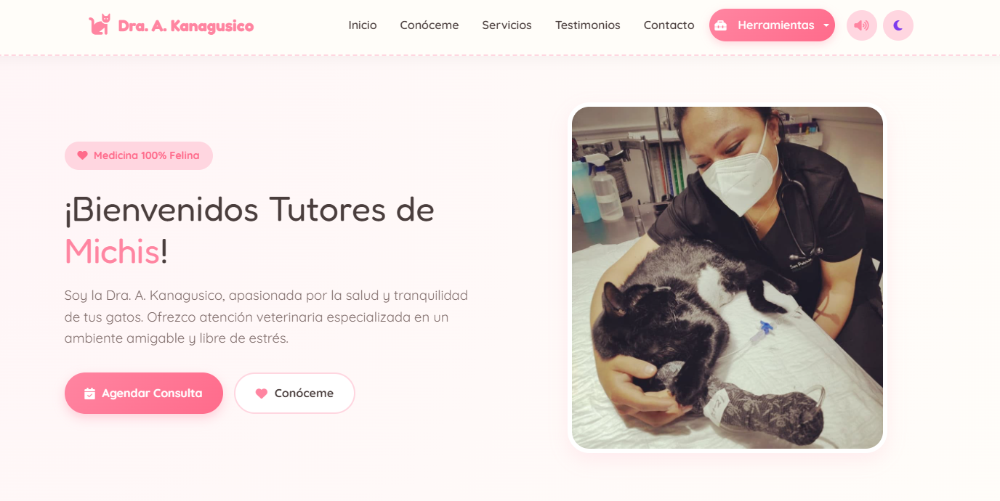

# 🐾 KanaVet | Dra. A. Kanagusico

Bienvenido al repositorio oficial de la página web de la **Dra. Araceli Kanagusico**, una plataforma integral diseñada para la **presentación profesional de la doctora**. Este proyecto combina una estética *"cat-friendly"* para atraer y dar confianza a los tutores, con un panel de herramientas clínicas reales que facilitan el día a día de la práctica veterinaria felina.

---

## 📖 ¿Qué hace nuestra web y por qué es útil?

El sitio web se divide en dos grandes bloques:

1. **Landing Page (Pública):** Dirigida a los tutores de gatos. Su objetivo es publicitar servicios veterinarios, generar confianza a través de la presentación de la doctora, mostrar testimonios y ofrecer un formulario directo para agendar citas. 
2. **Panel de Herramientas (Interno/Clínico):** Ubicado en el menú desplegable, es un conjunto de utilidades médicas diseñadas específicamente para **uso profesional** con el proposito de brindar a la doctora herramientas que fáciliten su práctica de la clinica veterinaria.
---

## 🛠️ Desglose de Herramientas y Lógica Matemática

Estas herramientas aplican fórmulas médicas reales validadas por la comunidad veterinaria internacional y están optimizadas para usarse rápidamente en consultorio:

### 1. 🧮 Calculadora de Dosis (`calculadoraDosis.js` / `CalculadoraDosis.html`)
*   **¿Por qué se eligió?** En medicina felina, el peso metabólico es crítico. Administrar dosis incorrectas puede ser fatal.
*   **¿Qué hace?** Calcula los mililitros exactos a administrar de un fármaco basándose en el peso del gato, la dosis prescrita (mg/kg) y la concentración del medicamento (mg/ml).
*   **Fórmula utilizada:** `Dosis Total (mg) = Peso (kg) * Dosis (mg/kg)`. Luego, `Volumen (ml) = Dosis Total / Concentración`.

### 2. ⏱️ Contador de Pulsos y Cronómetro (`cronometro.js` / `cronometro.html`)
*   **¿Por qué se eligió?** Los gatos son expertos en ocultar enfermedades. Medir la frecuencia cardíaca es el primer paso para detectar emergencias.
*   **¿Qué hace?** Emula el método clínico veterinario de **15 segundos**. El usuario da clic al ritmo del corazón del gato; al terminar el tiempo, el sistema multiplica los clics por 4 para obtener los **PPM (Pulsos Por Minuto)**.
*   **Lógica médica:** Al finalizar, evalúa el resultado. Si el gato está entre **120 y 220 PPM**, el número se pinta de verde (Normal). Si está fuera de este rango, se pinta de rojo (Alerta).

### 3. 🩻 Escala Grimace (`escalaGrimace.js` / `escalaGrimace.html`)
*   **¿Por qué se eligió?** Es el estándar de oro internacional (Feline Grimace Scale) para evaluar el dolor agudo en gatos sin necesidad de tocarlos.
*   **¿Qué hace?** Evalúa 3 facciones clave (orejas, ojos y hocico). Cada una vale de 0 a 2 puntos, dando un máximo de 6 puntos.
*   **Lógica médica:** Un puntaje de 0 indica relajación. De 1 a 3, dolor leve. De 4 a 6 (rojo), indica **dolor severo** y la necesidad urgente de analgesia.

### 4. ⚖️ Calculadora de Nutrición (`nutricion.js` / `nutricion.html`)
*   **¿Por qué se eligió?** La obesidad felina es una epidemia. Los tutores suelen sobrealimentar a sus gatos.
*   **¿Qué hace?** Calcula las kilocalorías diarias exactas (kcal/día) que debe comer un gato según su peso y estado fisiológico (esterilizado, entero, obeso, cachorro, etc.).
*   **Fórmula utilizada:** Usa la ley de Kleiber para el RER (Requerimiento Energético en Reposo): `RER = 70 * (Peso ^ 0.75)`. Luego multiplica por un factor (ej. 1.2 para esterilizados, 1.0 para bajar de peso).

### 5. 🖨️ Generador de Recetas (`recetario.js` / `recetario.html`)
*   **¿Por qué se eligió?** Agiliza la consulta médica. Permite al veterinario generar un documento formal en segundos.
*   **¿Qué hace?** Toma los datos del gato y el tutor. Tiene 3 funciones clave:
    1.  **Imprimir:** Usa CSS `@media print` para limpiar la pantalla (oculta menús y botones) y generar un PDF limpio.
    2.  **WhatsApp:** Codifica el texto y abre la app con el mensaje pre-redactado.
    3.  **Correo:** Usa el protocolo `mailto:` para abrir el gestor de correo del usuario con el asunto y cuerpo listos.

---

## 🎨 Diseño, Estilos y Experiencia de Usuario (UX)

El proyecto fue construido pensando en la calidez y el bienestar, alejándose del aspecto clínico tradicional para generar cercanía con los tutores.
*   **Paleta de colores:** Tonos pastel (Rosa `#FF8CA3`, crema `#FDF8F5`, verde menta). Transmite seguridad y cariño.
*   **Tipografías:** Uso de *Fredoka* (para títulos redondeados y amigables) y *Quicksand* (para lectura fluida en párrafos y formularios).
*   **Interacciones "Cute" (Detalles de diseño):**
    *   **Modo Oscuro (Dark Mode):** Implementado con variables CSS y guardado en `localStorage` para que el navegador recuerde la preferencia.
    *   **Partículas de patitas:** Al hacer clic en cualquier parte de la pantalla, aparece una animación de una huella (`🐾`).
    *   **Sonido Interactivo:** Uso de la *Web Audio API* de JavaScript para sintetizar sonidos (un "meow" y un "clic" suave) sin necesidad de descargar archivos de audio, haciendo la página más ligera.

---
## 💻 Tecnologías Utilizadas

Este proyecto fue desarrollado utilizando tecnologías web estándar, priorizando el rendimiento y la compatibilidad:

*   **HTML5:** Estructura semántica de todas las vistas.
*   **CSS3 (Vanilla):** Estilos personalizados, animaciones (keyframes), diseño responsivo y uso de variables CSS (`:root`) para el manejo de temas (Light/Dark mode).
*   **JavaScript (ES6+):** Lógica de las calculadoras, manejo del DOM, módulos para separar la lógica de cada herramienta.
*   **Bootstrap 5 (vía CDN):** Utilizado para la estructura de la barra de navegación (Navbar responsiva) y el menú desplegable de herramientas.
*   **FontAwesome 6 (vía CDN):** Para toda la iconografía (patitas, estetoscopio, WhatsApp, etc.).
*   **Google Fonts:** Para la carga de las tipografías *Fredoka* y *Quicksand*.
*   **Web Audio API:** Utilizada nativamente en JavaScript para generar los sonidos de "meow" y "clic" sin necesidad de cargar archivos MP3 externos para los efectos.

---

## ⚙️ ¿Cómo descargar e instalar el proyecto?

El proyecto es 100% Frontend (no requiere base de datos ni servidor backend), por lo que es muy fácil de ejecutar en local.

### Requisitos previos
Solo necesitas un navegador web moderno (Chrome, Firefox, Edge, Safari) y un editor de código (como [Visual Studio Code](https://code.visualstudio.com/)).

### Pasos para ejecutarlo:

1.  **Descargar o clonar el repositorio:**
    *   Si tienes Git instalado, abre tu terminal y ejecuta:
        ```bash
        git clone https://github.com/TuUsuario/Michi-Clinica.git
## 📜 Créditos y Derechos de Autor

Este proyecto fue desarrollado para la **Dra. A. Kanagusico** por la desarrolladora **Selene Kanagusico**. 

*   **Música de Fondo:** La pista musical utilizada para dar ambiente relajante a la página es **"Cat Cafe Lofi"**, creada por el artista **Snoozy Beats**. 
    *   *Licencia:* Descargada de la biblioteca de [Pixabay Music](https://pixabay.com/music/), bajo la **Licencia de Contenido de Pixabay**. Esto permite su uso gratuito en proyectos personales y comerciales sin necesidad de pagar regalías, aunque se otorga el crédito correspondiente al artista por ética profesional.
*   **Imágenes:** Las imágenes de los gatos y la veterinaria son fotografías de stock obtenidas de **Unsplash**, las cuales son de uso libre (Licencia Unsplash).
*   **Desarrollo:** Código HTML, CSS y JavaScript estructurado en módulos para su fácil mantenimiento.

---
**Aviso de Propiedad y Privacidad:**
Este repositorio se publica únicamente con fines demostrativos para el portafolio del desarrollador. **Todos los derechos están reservados.** Queda estrictamente prohibido clonar, copiar, modificar o reutilizar este código o los datos personales de la doctora (contacto, imágenes, información de la clínica) para fines propios o comerciales. Si deseas inspirarte en el diseño, por favor solo usar los css no los datos referentes a la doctora.

---
*Hecho con ❤️ para los michis.*